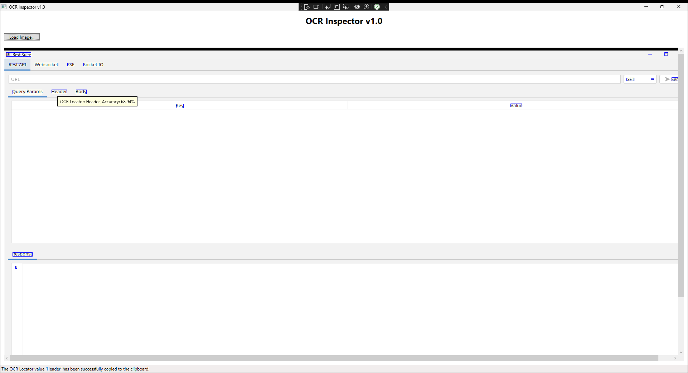

# OCR Inspector v1.0

[](https://github.com/g4-api/ocr-inspector/actions/workflows/GithubActions.yml)  

OCR Inspector is a WPF application that uses Tesseract OCR to process images, recognize text, and display the results with interactive elements. This application allows users to load images, perform OCR, and view the recognized words along with their confidence levels. Users can also copy OCR results to the clipboard directly from the UI.

## Features

- Load and display images in their original size.
- Take a screenshot of the primary display and inspect it.
- Show the screenshot and the OCR words of a running UiaDriver Server.
- Perform OCR with the same recognition and matching code as the UiaDriver Server.
- Display recognized words with bounding boxes.
- Interactive tooltips for recognized words showing the OCR locator and accuracy.
- Copy the OCR locator of a word to the clipboard.

## Screenshots



## Quick Start

### Prerequisites

- .NET Framework 8.0 or later
- Visual Studio 2022 or later
- [Emgu CV](https://www.emgu.com/wiki/index.php/Main_Page)
- [Tesseract OCR](https://github.com/tesseract-ocr/tesseract)

### Installation

If you want to OCR extra languages, download the [Tesseract language data files](https://github.com/tesseract-ocr/tessdata) and place them in a folder named `TrainData` in the root of your project directory or application.

#### From Source

1. **Clone the Repository:**

   ```sh
   git clone https://github.com/g4-api/ocr-inspector.git
   cd ocr-inspector
   ```

2. **Open the Solution:**

   Open `OcrInspector.sln` in Visual Studio.


#### From Releases

1. **Download the Latest Release:**

   Go to the [GitHub Releases](https://github.com/your-username/OcrInspector/releases) page.

2. **Download the ZIP File:**

   Download the ZIP file from the release assets.

3. **Unzip the File:**

   Extract the contents of the downloaded ZIP file.

### Usage

1. **Run the Application:**

   - If you built from source, press `F5` in Visual Studio to build and run the application.
   - If you downloaded the executable, double-click the `OcrInspector.exe` file.

2. **Load an Image:**

   - Click the "Load Image..." button to open a file dialog.
   - Select an image file (`.jpg`, `.jpeg`, `.png`, `.bmp`).

3. **Take a Screenshot:**

   - Click the "Take Screenshot" button.
   - The application hides itself, captures the primary display the same way the UiaDriver Server does, and shows the result.

4. **Inspect a Running Driver:**

   - Type the address of the UiaDriver Server in the address box. The default is `http://localhost:5555`.
   - Click the "From Driver" button.
   - The application hides itself and shows the screenshot and the words that the server recognized.
   - This needs the `-emgu` build of the server. The standard build has no OCR.

5. **View OCR Results:**

   - The application will display the image with recognized words highlighted.
   - Hover over the highlighted words to see tooltips with the OCR locator and accuracy.
   - Right-click on the highlighted words to copy the OCR locator to the clipboard.
   - A word that appears more than once gets an occurrence, such as `ocr('Submit')[2]`.

## Staying in Step with the UiaDriver Server

The files in `src/OcrInspector/Driver` are exact copies of files in the [UiaDriver Server](https://github.com/g4-api/uia-driver-server) repository. They hold the recognition code and the locator rules. When one of them changes in the server, copy it here again.

| File here | File in the server repository |
| --- | --- |
| `Driver/OcrEngine.cs` | `src/Uia.DriverServer.Domain/OcrEngine.cs` |
| `Driver/OcrLocator.cs` | `src/Uia.DriverServer.Domain/OcrLocator.cs` |
| `Driver/OcrModels.cs` | `src/Uia.DriverServer.Models/OcrModels.cs` |
| `Driver/RectangleModel.cs` | `src/Uia.DriverServer.Models/RectangleModel.cs` |

Both projects must use the same Emgu.CV version and the same `TrainData/eng.traineddata` file. A different version can recognize small text differently.

## License

This project is licensed under the MIT License - see the [LICENSE](LICENSE) file for details.
